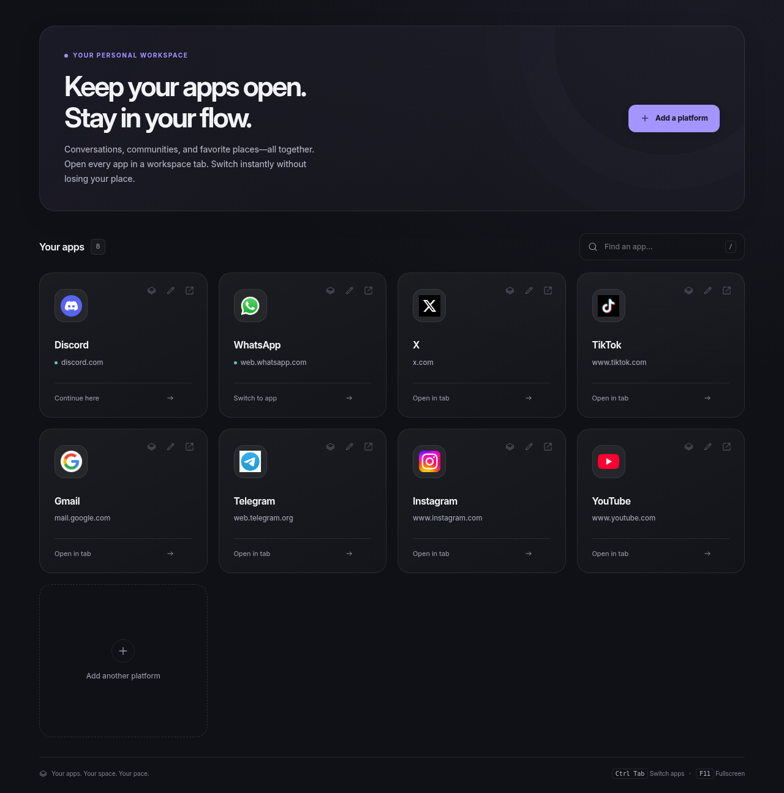

# Social Workspace

Keep your favorite websites together in one desktop app.



## Run on Windows

1. Install [Python 3.12, 64-bit](https://www.python.org/downloads/windows/).
2. Click **Code → Download ZIP** above, then extract it.
3. Open the extracted folder and double-click **START-WINDOWS.bat**.

The first launch installs the required packages. Keep the window open while it finishes.

## Use it

- Click an app to open it in a tab. Use **+** to choose another app.
- Click **Add a platform** and enter its name and website link. A picture is optional.
- Have a website QR code? Click **Read QR image** to get its link from a saved picture.
- Open **Settings** to change workspace colors, text size, and the fullscreen shortcut.
- Hover over an app card: use the pencil to change its picture, the trash icon to remove it, or the arrow to open a separate window.
- **F11** toggles website fullscreen. **Ctrl+Tab** switches tabs.

Apps, settings, and website sessions are saved locally. QR images are read on your device.

## Run manually

Open a terminal in this folder:

```bat
py -m pip install -r requirements.txt
py social_workspace.py
```

Tested with 16 passing tests on Linux. Windows has not been tested here. Some websites may restrict embedded browsers or sign-in. Internet is required for websites and the first-time setup.

The full app is in **social_workspace.py**. The other files are a launcher, dependencies, these instructions, and license notices. See **LICENSES.txt** for licensing.
